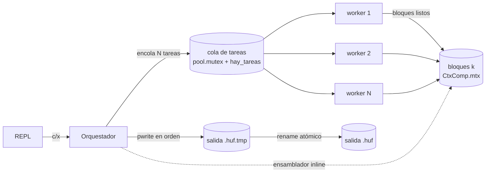
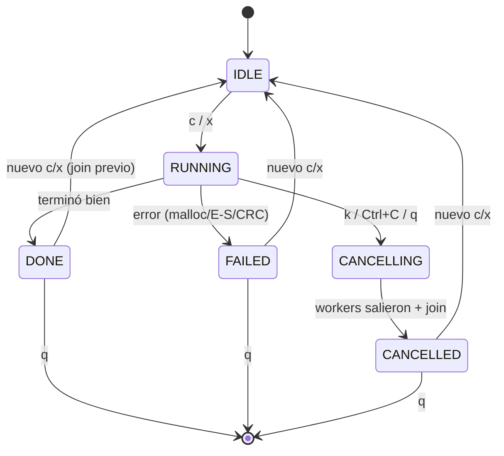

# Protocolo de concurrencia del compresor Huffman

> Documento derivado del código real (`huffman.c`, `hilos.c`, `huf_editor.c`,
> y los cambios aditivos en `editor.c`). Describe exactamente lo que el código
> hace, para poder defender el diseño en la sustentación.

## 1. Inventario de hilos

| Hilo | Creado por | Cuántos | Qué hace |
|------|-----------|---------|----------|
| **REPL** | proceso del editor (`editor_run`) | 1 | Lee comandos de `stdin`, despacha. Lanza/consulta/cancela el trabajo. Nunca hace trabajo pesado; solo se bloquea esperando a otros en `w`, `q` y EOF. |
| **Orquestador** | `he_comprimir`/`he_descomprimir` → `lanzar` → `pthread_create` (en `huf_editor.c`) | 1 por trabajo | Corre las fases del motor (`huf_comprimir_concurrente`/`huf_descomprimir_concurrente`), actúa como **ensamblador** en la compresión, publica el estado final. |
| **Workers del pool** | `hilos_crear` → `pthread_create` (en `hilos.c`) | `N` (= `sysconf(_SC_NPROCESSORS_ONLN)`, tope 8; configurable) | Ejecutan tareas: contar frecuencias (fase 1), codificar bloques (fase 2) o decodificar bloques (descompresión). |

No hay un hilo ensamblador aparte: **el ensamblador es el propio orquestador**,
que ejecuta `comp_ensamblador` de forma *inline* tras encolar las tareas
codificadoras (ver §Decisiones). En la descompresión no hay ensamblador: cada
worker escribe su bloque en un destino disjunto.

## 2. Recursos compartidos y su protección

### 2.1 Pool genérico (`hilos.c`)

| Dato | Primitiva | Lectores/Escritores | Invariante |
|------|-----------|---------------------|------------|
| Cola FIFO de tareas (`cabeza`,`cola`) | `mutex` | workers desencolan; productor encola | Un nodo se desencola una sola vez; se ejecuta fuera del lock. |
| `pendientes`, `en_curso` | `mutex` | workers y productor | `pendientes==0 && en_curso==0` ⇒ se señaliza `cola_vacia`. |
| `apagando` | `mutex` | `hilos_destruir` escribe; workers leen | Si está en 1 y la cola está vacía, cada worker retorna. |
| `cancelado` | `mutex` | `hilos_cancelar` escribe; `hilos_cancelado` lee | Monótona: solo pasa de 0 a 1. |
| condvar `hay_tareas` | — | workers esperan; encolar/apagar señalizan | Los workers duermen aquí si la cola está vacía. |
| condvar `cola_vacia` | — | `hilos_esperar` espera; último worker señaliza | Barrera de fin de fase. |

### 2.2 Fase 1 — conteo (`CtxConteo` en `huffman.c`)

| Dato | Primitiva | Notas |
|------|-----------|-------|
| `parciales[k][256]` (histograma por tarea) | **ninguna** | Cada tarea escribe SOLO su fila `k`: no hay dato compartido durante el conteo ⇒ cero contención. |
| histograma global | **ninguna** | Lo suma el coordinador tras `hilos_esperar` (la barrera), con un solo hilo activo. |
| `error`, `hechos` (progreso) | `mtx` | Secciones críticas mínimas (una por bloque). |

### 2.3 Fase 2 — codificación + ensamblado (`CtxComp` en `huffman.c`)

| Dato | Primitiva | Notas |
|------|-----------|-------|
| Tabla de códigos `HufCodigos` | **ninguna (solo lectura)** | Se construye UNA vez antes de encolar; los workers solo la leen. Lectura concurrente de memoria inmutable no requiere lock. |
| `sig_asignar` (reparto de índices) | `mtx` | Cada worker toma `k = sig_asignar++`. |
| `bloques[k]` (buffer, `listo`) | `mtx` | El worker lo marca `listo`; el ensamblador lo consume y libera. |
| `sig_escribir`, `cursor_escr` | `mtx` | Solo el ensamblador los avanza. |
| tabla de bloques en disco | — | La escribe solo el ensamblador (en orden), sin carrera. |
| condvar `cond_listo` | — | El ensamblador espera a que `bloques[sig_escribir].listo`. |
| condvar `cond_ventana` | — | Los workers esperan para entrar en la ventana por índice. |

### 2.4 Descompresión (`CtxDesc` en `huffman.c`)

| Dato | Primitiva | Notas |
|------|-----------|-------|
| tabla de bloques (entrada) | **ninguna (solo lectura)** | Inmutable tras cargarse. |
| archivo de salida | **ninguna** | Cada tarea escribe en `k*tam_bloque`; destinos **disjuntos** (ver §6), sin solape ⇒ sin lock ni orden. |
| `error`, `hechos` | `mtx` | Secciones críticas mínimas. |

### 2.5 Integración con el editor (`HufEditor` en `huf_editor.c`)

| Dato | Primitiva | Lectores/Escritores | Invariante |
|------|-----------|---------------------|-----------|
| Máquina de estados (`estado`, rutas, progreso, `hay_hilo`) | `estado_mtx` + `estado_cv` | REPL escribe/lee; orquestador publica el estado final | Toda transición y toda consulta (`t`,`k`,`w`,`q`) pasan por aquí. |
| `cancelar` (bandera de cancelación) | **atómica** (`__atomic_*`, relaxed) | REPL/`he_destruir` escriben 0→1; workers del motor leen entre bloques | Monótona 0→1; se lee sin lock pero de forma atómica. |
| Carrera con la edición | **solo el estado** (bajo `estado_mtx`) | `a`/`d`/`i` consultan; `lanzar` publica RUNNING | Si el estado es RUNNING/CANCELLING, `a`/`d`/`i` se rechazan. No hay lock de archivo. |
| Salida por `stdout` (prompt + progreso) | `salida_mtx` | REPL y orquestador escriben | Serializa las líneas para que no se entremezclen. |
| `g_sigint` | `volatile sig_atomic_t` | el manejador de SIGINT escribe; el REPL lee | Única variable tocada por el manejador (async-signal-safe). |

## 3. Orden global de adquisición de locks (ausencia de interbloqueo)

Hay DOS mutex en la integración y **nunca se anidan** uno dentro del otro, así
que no puede haber inversión de orden:

```
estado_mtx   (nunca se mantiene mientras se toma salida_mtx, y viceversa)
salida_mtx   (hoja)
pool.mutex   y   CtxComp.mtx/CtxConteo.mtx/CtxDesc.mtx  son HOJAS
```

- `salida_mtx` es una **hoja**: `he_printf`/`he_err` lo toman y lo sueltan sin
  anidar ningún otro lock dentro.
- `estado_mtx` también se usa de forma no anidada: cuando hay que imprimir, se
  **suelta** `estado_mtx` primero y luego se llama a la salida. Así nunca se
  mantienen los dos a la vez.
- No existe ningún `pthread_rwlock`: la antigua inversión de orden (y el error de
  ThreadSanitizer por soltar un rwlock desde un hilo distinto del que lo tomó) ya
  no es posible, porque la exclusión con la edición se decide solo por el estado.
- Los mutex de los contextos del motor (`CtxComp.mtx`, etc.) y `pool.mutex` son
  hojas: el trabajo pesado (E/S, codificación) se hace **fuera** de ellos.

Como ningún camino invierte el orden declarado, no existe ciclo en el grafo de
locks ⇒ no hay interbloqueo. ThreadSanitizer confirma la ausencia de inversión.

### 3.1 La ventana por índice no interbloquea (fase 2)

Regla: el bloque `i` solo arranca si `i < sig_escribir + W`, con `W = 2·N ≥ N`.
El ensamblador necesita el bloque `sig_escribir`. Como `sig_escribir <
sig_escribir + W`, ese bloque **siempre** está dentro de la ventana, así que
algún worker siempre tiene permiso de procesarlo. Por tanto el ensamblador nunca
espera por un bloque que ningún worker puede empezar. Los bloques `≥
sig_escribir + W` quedan fuera de la ventana y no acaparan memoria ni cupos.
(El diseño ingenuo —un búfer de salida de capacidad fija donde los workers
depositan cualquier bloque— se interbloquea cuando todas las ranuras las ocupan
bloques posteriores al que el ensamblador espera y el worker que tiene ese
bloque queda esperando una ranura libre.)

## 4. Ausencia de espera activa

Todo punto de espera **bloquea** en una condvar o semáforo; no hay spin-loops ni
`sleep`/`usleep` para esperar un evento. Puntos de espera:

| Punto | Dónde | Bloquea en |
|-------|-------|------------|
| Worker sin tareas | `worker` (`hilos.c`) | `pthread_cond_wait(hay_tareas)` |
| Fin de fase / barrera | `hilos_esperar` | `pthread_cond_wait(cola_vacia)` |
| Ensamblador espera el próximo bloque | `comp_ensamblador` | `pthread_cond_wait(cond_listo)` |
| Worker fuera de la ventana | `comp_tarea` | `pthread_cond_wait(cond_ventana)` |
| `w` (comando) | `he_esperar` | `pthread_cond_wait(estado_cv)` |
| `q`/EOF con trabajo | `he_destruir` → `pthread_join` | join (bloqueante) |

(El único `nanosleep` del código está detrás de `-DHUF_LENTO`, exclusivo de las
pruebas, para forzar bloques fuera de orden; no es una espera de sincronización.)

## 5. Diagramas

### 5.1 Hilos y colas (compresión)



### 5.2 Secuencia: c → progreso → fin

```mermaid
sequenceDiagram
    participant U as Usuario
    participant R as REPL
    participant O as Orquestador
    participant W as Workers
    U->>R: c
    R->>R: estado=RUNNING (bajo estado_mtx)
    R->>O: pthread_create
    R-->>U: vuelve al prompt
    O->>W: fase 1 (conteo) + barrera
    O->>O: construir árbol (1 vez)
    O->>W: fase 2 (codificar)
    W-->>O: bloque k listo (cond_listo)
    O->>O: pwrite en orden; progreso 10/20/... (global y monótono)
    O-->>U: [huf] 100 % terminado (salida)
    O->>R: estado=DONE; estado_cv
    U->>R: w  (si estaba esperando, retorna)
```

### 5.3 Máquina de estados del trabajo



## 6. Destinos disjuntos en la descompresión (sin lock de escritura)

El bloque `k` original ocupa `[k·B, k·B + len_o_k)` en la salida, con `len_o_k ≤
B` (es exactamente `B` salvo el último bloque, que puede ser menor). El bloque
`k+1` empieza en `(k+1)·B ≥ k·B + len_o_k`. Por tanto los rangos de escritura de
bloques distintos **no se solapan**: cada `pwrite` toca bytes exclusivos. En
`desc_tarea` hay una aserción de rango (`destino + len_o ≤ total` y `len_o ≤ B`)
que respalda este argumento y rechaza un `.huf` corrupto antes de escribir.

## 7. Análisis de la carrera con la edición

Intercalados posibles entre el REPL (que edita con `a`/`d`/`i`) y los workers
(que leen el archivo):

La clave es que **el REPL es monohilo**: los comandos de edición (`a`/`d`/`i`) y
los de trabajo (`c`/`x`) se ejecutan en el MISMO hilo, uno tras otro, nunca en
paralelo entre sí. El único paralelismo real es REPL ↔ workers del motor, y los
workers **no** editan: solo leen el archivo con su propio `fd`.

1. **Edición mientras un worker lee bytes que se están desplazando.** `d`/`i`
   mueven bytes del archivo con `lseek+read+write`; si un worker leyera a la vez,
   obtendría datos inconsistentes. **Impedido:** `a`/`d`/`i` llaman a
   `he_inicio_edicion`, que consulta el estado bajo `estado_mtx`; si hay un
   trabajo RUNNING/CANCELLING, la edición se **rechaza sin tocar nada**.
2. **Ventana entre "arrancó el trabajo" y "a/d/i consulta el estado".** El estado
   pasa a RUNNING dentro de `lanzar`, **antes** de `pthread_create` y antes de que
   `c`/`x` retorne al prompt. Como el siguiente comando (`a`/`d`/`i`) lo procesa
   el mismo hilo del REPL, cuando llega ya ve RUNNING: no hay ventana. Por eso no
   hace falta ningún lock de archivo (y se eliminó el `pthread_rwlock` que antes
   lo intentaba y provocaba un unlock desde otro hilo, prohibido por POSIX y
   marcado por ThreadSanitizer).
3. **`p`/`s` durante el trabajo.** Solo leen la lista en memoria, no el archivo;
   no consultan el estado de edición, así que responden normalmente aunque haya
   trabajo.

Correctitud adicional: el trabajo abre su **propio** descriptor (`open` en el
motor), nunca `ed->fd`; y la salida de `x` nunca puede ser el archivo abierto
(se valida en `ed_descomprimir`).

## 8. Decisiones de diseño y alternativas descartadas

- **Tamaño de bloque (64 KiB por defecto).** Suficientemente grande para
  amortizar el costo por tarea y la E/S; suficientemente chico para dar
  paralelismo en archivos medianos. Las pruebas usan 1–4 KiB para forzar muchos
  bloques. Alternativa descartada: bloque fijo gigante (poca concurrencia) o
  diminuto (demasiada sincronización).
- **Número de hilos = CPUs (tope 8).** El trabajo es mayormente CPU
  (codificación) con algo de E/S; igualar a los núcleos aprovecha el paralelismo
  sin sobre-suscribir. Configurable por `HufOpc.nhilos`.
- **Histograma local por tarea vs global con lock.** Se eligió **local + reducción
  en el coordinador**: durante el conteo no hay dato compartido, así que no hay
  contención por byte ni por bloque. Alternativa descartada: sumar al histograma
  global bajo un mutex (serializa el conteo).
- **Ensamblador = orquestador inline vs hilo propio en el pool.** Ejecutarlo como
  una tarea más del pool podría dejarlo sin hilo si los `N` workers toman tareas
  codificadoras (interbloqueo). Se ejecuta en el orquestador, que de otro modo
  solo esperaría.
- **Rechazar vs esperar en `a`/`d`/`i`.** Se **rechaza** (consultando el estado): es
  predecible para el usuario y evita bloquear el REPL. Esperar hasta que termine
  el trabajo congelaría la edición un tiempo indeterminado.
- **Tabla de bloques con CRC32.** Permite descompresión concurrente (localizar y
  verificar cada bloque sin leer los anteriores) y detectar corrupción.
- **Temporal + `rename` atómico.** La salida final aparece completa o no aparece;
  nunca a medias. Ante error/cancelación se hace `unlink` del temporal.
- **Sin `rwlock` para la carrera con la edición.** Una versión anterior usaba un
  `pthread_rwlock` que el REPL tomaba y el orquestador soltaba; POSIX exige que un
  rwlock lo suelte el hilo que lo tiene, y ThreadSanitizer lo marcaba. Como el
  REPL es monohilo, basta decidir por el **estado** bajo `estado_mtx`: más simple,
  sin inversión de orden y sin violar POSIX.
- **Bandera de cancelación atómica, no `volatile`.** `volatile` no da atomicidad
  entre hilos; se usa `__atomic_load_n`/`__atomic_store_n` (orden relaxed, que
  basta porque solo importa publicar el cambio 0→1).
- **Progreso global y monótono.** La compresión tiene dos fases; para que `t`
  nunca muestre un porcentaje que baje, se reporta sobre un total de `2*nbloques`
  (conteo = primeras `nbloques` unidades, 0–50%; codificación = segundas,
  50–100%). La descompresión es una sola fase, 0–100%.
  Dos detalles garantizan que lo **mostrado** no retroceda: (1) los workers del
  conteo y de la descompresión llaman al callback de progreso después de soltar
  su mutex, así que dos avisos pueden llegar invertidos; `cb_progreso` solo acepta
  un valor mayor que el guardado. (2) El valor se lee bajo `estado_mtx` pero se
  imprime bajo `salida_mtx`; `pct_monotono` (con `salida_mtx` tomado, en la misma
  sección crítica que imprime) nunca deja imprimir un porcentaje menor al último
  impreso del mismo trabajo. Sin esto, la prueba de progreso monótono de la
  descompresión fallaba de forma intermitente.

## 9. Diez preguntas de sustentación (con respuesta fundamentada en el código)

1. **¿Por qué `pread`/`pwrite` y no `lseek`+`read`/`write` en los workers?**
   Porque el offset del descriptor es estado compartido: con un fd compartido,
   `lseek`+`read` de dos hilos se pisan. `pread`/`pwrite` llevan el offset como
   argumento y no tocan el cursor, así que son seguros entre hilos (ver
   `pread_todo`/`pwrite_todo`).

2. **¿Cómo se garantiza que la tabla de códigos no necesita lock en fase 2?**
   Se construye una sola vez (`huf_construir`) *antes* de encolar las tareas; a
   partir de ahí es memoria inmutable (`const HufCodigos *cods`). La lectura
   concurrente de datos que nadie modifica no requiere exclusión.

3. **¿Qué pasa si un worker falla (p. ej. `malloc`) a mitad de la fase 2?**
   Marca `error` bajo `mtx`, hace `broadcast` de `cond_listo` y `cond_ventana`
   para despertar a quien espere, y llama `hilos_cancelar`. Todos los hilos ven
   la condición y salen; el orquestador hace join de todos y reporta FAILED; el
   temporal se borra.

4. **¿Por qué `W ≥ N` evita el interbloqueo del ensamblado?** Porque el bloque
   `sig_escribir` que el ensamblador necesita siempre cae dentro de la ventana
   `[sig_escribir, sig_escribir+W)`, luego algún worker puede procesarlo; el
   ensamblador nunca espera por un bloque "prohibido". (§3.1)

5. **¿Dónde está la barrera entre fase 1 y fase 2?** En `hilos_esperar`, que
   bloquea hasta `pendientes==0 && en_curso==0`. Tras ella, un solo hilo (el
   coordinador) suma los histogramas y construye el árbol.

6. **¿Cómo se cancela sin espera activa y sin dejar basura?** `k`/Ctrl+C/`q`
   activan la bandera atómica `he->cancelar` (con `__atomic_store_n`; en Ctrl+C,
   además la bandera `sig_atomic_t`). El motor la lee de forma atómica entre
   bloques (`huf_cancel_externa` con `__atomic_load_n`) y propaga `hilos_cancelar`.
   Todos los hilos se unen con `pthread_join` (`hilos_destruir`), y el temporal se
   borra con `unlink`. Nunca se usa `pthread_detach`.

7. **¿Por qué el manejador de SIGINT solo pone una bandera?** Porque dentro de un
   manejador no se puede llamar a `pthread_mutex_*`, `pthread_cond_*` ni `printf`
   (no son async-signal-safe). El manejador escribe `g_sigint`; el REPL la lee
   (`he_sigint_pendiente`) y traduce a cancelación por el flujo normal. Los
   workers bloquean SIGINT con `pthread_sigmask`, así la recibe solo el principal.

8. **¿Cómo se evita que `a`/`d`/`i` corrompan un bloque que un worker está
   leyendo?** Por el **estado**, no por un lock de archivo: `a`/`d`/`i` llaman a
   `he_inicio_edicion`, que bajo `estado_mtx` rechaza si el trabajo está
   RUNNING/CANCELLING. Como el REPL es monohilo y el estado ya es RUNNING cuando
   `c`/`x` retorna (se fija en `lanzar` antes de `pthread_create`), no hay ventana
   en la que una edición se cuele. El trabajo además lee con su **propio** `fd`.
   (§7)

9. **¿Por qué no hay inversión de orden de locks?** Porque solo quedan dos mutex
   (`estado_mtx` y `salida_mtx`) y **nunca se anidan**: para imprimir se suelta
   `estado_mtx` antes de tomar `salida_mtx`. Ya no existe el `pthread_rwlock` que
   antes se anidaba con `estado_mtx` (y que, además, se soltaba desde un hilo
   distinto del que lo tomaba, lo que ThreadSanitizer marcaba). TSan ahora no
   reporta inversión ni unlock indebido. (§3)

10. **¿Qué garantiza que la salida final nunca quede corrupta?** Se escribe a
    `salida.tmp` y solo si todo terminó bien se hace `rename(tmp, salida)`, que es
    atómico en el mismo sistema de archivos. Ante error o cancelación se hace
    `unlink(tmp)`. Además la descompresión usa `O_EXCL` para no sobrescribir en
    silencio un archivo existente.

## 10. Evidencia: secuencial vs concurrente

Medición en WSL2 Ubuntu 24.04, GCC 13.3.0, 12 CPUs lógicas. Entrada de 64 MiB
(67 108 864 bytes): 16 tramos de 3 MiB de texto repetido + 1 MiB de bytes
aleatorios. Compresión con el CLI de pruebas (`make huf_cli`), bloque de 64 KiB,
tiempo real de 3 corridas por modo:

| Modo | Comando | Corridas (s) | Mediana (s) | Speedup |
|------|---------|--------------|-------------|---------|
| Secuencial (`huf_comprimir_archivo`) | `./huf_cli c in.bin o.huf` | 2.060, 2.094, 2.003 | 2.060 | 1.00x |
| Concurrente, pool de 1 hilo | `./huf_cli C in.bin o.huf 1` | 1.997, 2.040, 2.029 | 2.029 | 1.02x |
| Concurrente, pool automático (8 hilos) | `./huf_cli C in.bin o.huf 0` | 0.489, 0.481, 0.524 | 0.489 | 4.21x |

Integridad de la ida y vuelta sobre el mismo archivo (SHA-256 idéntico):

```
36c774f7acbf85c34db808c633704fc6e03aadc7a022fc40490f4e1bb2e290eb  in.bin
36c774f7acbf85c34db808c633704fc6e03aadc7a022fc40490f4e1bb2e290eb  par.rt   (C + X, concurrente)
36c774f7acbf85c34db808c633704fc6e03aadc7a022fc40490f4e1bb2e290eb  seq.rt   (c + x, secuencial)
```

Ambas versiones producen un `.huf` de 50 454 489 bytes. Con 1 hilo el pool
cuesta lo mismo que la versión secuencial, así que la sincronización agrega poco;
la ganancia viene del paralelismo real. La sección 6 de `tests/run_tests_huf.sh`
repite una medición más chica (N = 1, 2, 4, 8) en cada corrida de `make test-huf`.
